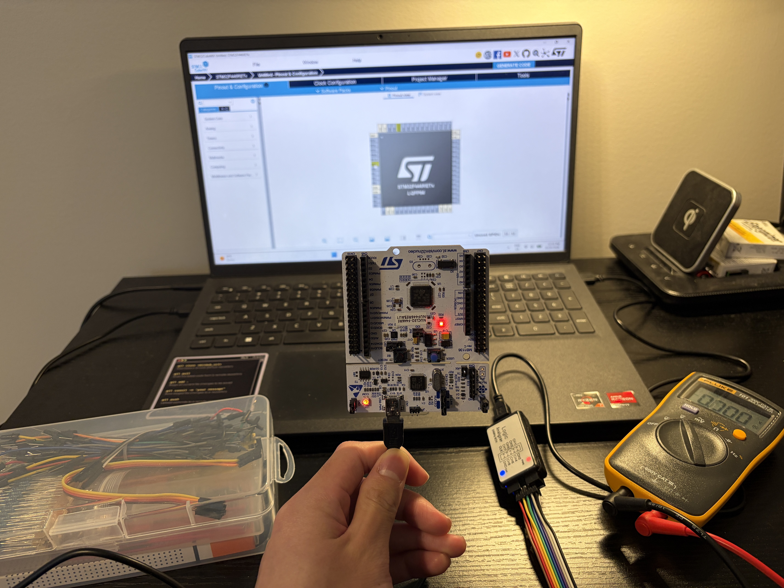
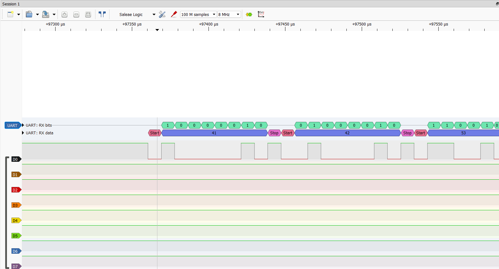

# Firmware-60-day-Challenge

I followed an AI-generated, 60-day embedded systems roadmap for ~2 hours a day: bare-metal STM32, ARM Cortex-M, debugging, and FreeRTOS. Then I used those skills to build my next project: a [**Dog Communication Device**](https://github.com/ethanluoeng/Dog_Communication_Device).
- **Time invested:** ~100 hours over 60 days
- **Hardware:** STM32 Nucleo-F446RE, MPU-6050 IMU Breakout, logic analyzer, multimeter
- **Biggest lesson:** Always check which pins a dev board reserves before you debug them (see [Bug I hunted](#bug-i-hunted-the-reserved-pins))
 
<p align="center">
  
</p>

## Repository Structure

```
Firmware-60-day-Challenge/
├── Week1-C/
├── Week 2 - STM32 toolchain, ARM Cortex-M/
├── Week3-Debugging/
│   └── UART_command_line_interface/
├── Week6-FreeRTOS/
├── Daily_Logs.txt
└── embedded_2month_plan.pdf
```

## Weekly Breakdown

### Daily Logs
[Daily Logs](Daily_Logs.txt) is where I kept track of everything new I learned each day. 

### Week 1 - C
Worked through Beej's Guide to C, covering pointers, memory management, structs, bitfields, macros, and multithreading. Wrote example code that surfaced classic pitfalls like dangling pointers, building a stronger intuition for how C manages memory under the hood.

| Topic | Code in repo | Notes |
|---|---|---|
| Dynamic memory | [✅ linked_list](Week1-C/linked_list.c) | Singly linked list with `malloc`'d nodes, search, delete via a `node **` to handle removing the head, and a `free_list` that NULLs the head afterward to avoid a dangling pointer. |
| Data structures | [✅ ring_buffer](Week1-C/ring_buffer.c) | Fixed-capacity circular buffer with modulo head/tail wraparound that overwrites the oldest value when full, plus `assert`-based unit tests for init, empty reads, full, and overwrite cases. |
| State machines | [✅ struct_based_FSM](Week1-C/struct_based_FSM.c) | Table-driven vending machine FSM where each `transition` struct maps a state/input pair to a next state and an action function pointer. |

### Week 2 - STM32 Toolchain, ARM Cortex-M
Learned bare-metal register-level programming on an STM32 Nucleo board, covering GPIO, UART, ADC, timers, interrupts, DMA, I2C, and SPI by writing to peripheral registers directly instead of using HAL. Also dug into the toolchain itself, studying the compile/link process, linker scripts, the Reset_Handler, SWD debugging, and writing a Makefile from scratch.

| Peripheral | Code in repo | Notes |
|---|---|---|
| GPIO | [✅ 4_gpio_input](Week%202%20-%20STM32%20toolchain,%20ARM%20Cortex-M/4_gpio_input/Src/main.c) | Reads the PC13 user button through `IDR` and drives the PA5 LED with atomic `BSRR` set/reset writes. |
| UART | [✅ 16_uart_rx_interrupt](Week%202%20-%20STM32%20toolchain,%20ARM%20Cortex-M/16_uart_rx_interrupt/Src/uart.c) | Full USART2 TX/RX driver with a rounded `BRR` baud calculation, `printf` retargeting, and an RXNE interrupt that toggles the LED on `'1'`. |
| ADC | [✅ 10_adc_continous_conversion](Week%202%20-%20STM32%20toolchain,%20ARM%20Cortex-M/10_adc_continous_conversion/Src/adc.c) | Configures ADC1 channel 1 on PA1 through `SQR1`/`SQR3` and runs it in continuous-conversion mode, polling `EOC` for each result. |
| Timers | [✅ 14_InputCapture](Week%202%20-%20STM32%20toolchain,%20ARM%20Cortex-M/14_InputCapture/Src/timer.c) | TIM2 output compare toggles PA5 at 1 Hz in hardware, and TIM3 input capture on PA6 (jumpered to PA5) timestamps each edge in milliseconds. |
| Interrupts | [✅ 15_InputInterrupt](Week%202%20-%20STM32%20toolchain,%20ARM%20Cortex-M/15_InputInterrupt/Src/exti.c) | Routes PC13 to EXTI13 via `SYSCFG`, unmasks a falling-edge trigger, enables it in the NVIC, and clears the pending bit in the handler. |
| DMA | [✅ 20_uart_tx_dma](Week%202%20-%20STM32%20toolchain,%20ARM%20Cortex-M/20_uart_tx_dma/Src/uart.c) | DMA1 Stream 6 / Channel 4 streams a string from memory into `USART2->DR` with no CPU involvement, and a transfer-complete interrupt lights the LED. |
| I2C | [✅ 21_I2C_adxl345](Week%202%20-%20STM32%20toolchain,%20ARM%20Cortex-M/21_I2C_adxl345/Src/i2c.c) | Register-level I2C1 driver on open-drain PB8/PB9 that burst-reads the MPU-6050's six accelerometer bytes and combines them into signed 16-bit axes. |
| SPI | [✅ 22_SPI_mpu6050](Week%202%20-%20STM32%20toolchain,%20ARM%20Cortex-M/22_SPI_mpu6050/Src/spi.c) | SPI1 master driver (mode 3, MSB-first, software chip select on PA9) that compiles but was never run on hardware, because the MPU-6050 turned out not to support SPI. |

### Week 3 - Debugging
Practiced debugging workflows using STM32CubeIDE and SWV views, and learned a hard lesson about checking a new MCU's reserved pins after losing a day chasing a logic analyzer issue caused by pins reserved for the ST-Link debugger. Built a UART command-line interface using a statically allocated ring buffer, reinforcing embedded conventions around avoiding dynamic allocation.



*USART3 TX (PB10) captured on the logic analyzer, with PulseView's UART decoder translating the waveform into readable bytes.*
 
#### Bug I hunted: the reserved pins
- **Symptom:** The logic analyzer received no signal at all from PA2 and PA3.
- **What I tried:** I stripped the firmware down to a bare HAL project that just drove PA2/PA3 as plain GPIO outputs (toggling them, then forcing them high) to rule out my UART configuration, and still saw nothing.
- **Root cause:** Pins PA2/PA3 are reserved on the Nucleo for the onboard ST-Link debugger, so USART2 TX/RX were routed to the ST-Link's virtual COM port instead of out to the header where my analyzer was connected.
- **Fix:** I moved my test signals to free pins (PA4/PA6) to confirm the analyzer worked, then switched the UART capture to USART3 (TX on PB10, RX on PC5), which produced the decoded capture above.
- **Lesson:** Read the board's user manual and schematic for reserved and solder-bridged pins *before* wiring anything up. This cost me a full day.

### Week 4 - FreeRTOS
Studied FreeRTOS fundamentals from "Mastering the FreeRTOS Real Time Kernel," including kernel ports, configuration files, tick interrupts, and the different heap memory management schemes (Heap_1 through Heap_5). Set up FreeRTOS in STM32CubeMX and learned task management concepts, including how tasks are structured, created, and scheduled.

## Tools & Hardware
 
| Item | Purpose | Approx. price |
|---|---|---|
| STM32 Nucleo-F446RE | Main development board for bare-metal and FreeRTOS work | ~$20 |
| Logic analyzer | Capturing and decoding UART/I2C/SPI signals | ~$15 |
| Multimeter | Continuity, voltage, and current checks | ~$50 |
| MPU-6050 IMU Breakout | Provides real-time raw measurements | ~$10 |

 
**Software:** STM32CubeIDE v2.2.0, STM32CubeMX, arm-none-eabi-gcc, PulseView, Realterm
 
The full plan, including the original shopping list, is in [embedded_2month_plan.pdf](embedded_2month_plan.pdf).

## AI Documentation

### Prompts Used to Create the 60-Day Plan

**Prompt 1:**
```
I'm currently studying mechatronics. Acting as a senior engineer with deep, current knowledge of the field and a strong sense of where it's heading, recommend 5 skills worth investing significant time in — ones I can realistically learn using just my laptop (plus maybe a few affordable components/hardware). Each skill should have strong potential to lead to a well-paying job in the next few years. 

The skills don't need to be strictly mechatronics, but they should meaningfully overlap with my education so the effort compounds rather than scatters. For each skill, briefly explain: why it's in demand now, why you expect that to hold or grow, and what a realistic learning path looks like from scratch. Please research current job market trends and industry signals rather than relying purely on general assumptions.
```

**Prompt 2:**
```
Create an intensive 2-month learning plan covering exactly this scope — nothing more, nothing less:

Topics to learn: C programming in depth (memory layout, undefined behavior, linker scripts), one RTOS (FreeRTOS or Zephyr — note Zephyr's rising adoption), ARM Cortex-M architecture, peripheral programming (I2C, SPI, UART, CAN), interrupt handling, and hands-on use of a logic analyzer and oscilloscope.

Hardware to buy: an STM32 Nucleo board (~$20), a Raspberry Pi Pico (~$5), a budget logic analyzer/Saleae clone (~$15), and a decent multimeter (~$50) — no other purchases.

End goal: build one real, substantial project (e.g., a brushless motor controller, a sensor logger, or a CAN bus sniffer) and publish it on GitHub with documentation and captured scope/logic-analyzer traces. This portfolio piece is meant to substitute for the "years of experience" credential gap.

Structure the plan week-by-week, sequencing topics so hardware purchases align with when they're needed and the final project builds naturally out of the skills learned earlier. Include a clearly organized shopping list (item, purpose, approximate price) separate from the weekly plan.

Once the plan is finalized, compile it into a PDF.
```

### AI Errors
1. **Claim:** "Add Phil's Lab on YouTube (@PhilsLab) — his videos use VS Code + PlatformIO, closer to professional practice."
   **Reality:** Phil's Lab mainly uses STM32CubeIDE, not PlatformIO.
   **How I caught it:** Watched several of his videos on setting up his toolchain and programming his STM32.

## Reflection
Last summer, I had 3 problems: I was worried that AI would replace my future job, I wanted to get serious about embedded systems, and I had no project idea. This challenge solved all 3, so overall, it was a success. By committing around two hours a day for two months, I deepened my understanding of microcontrollers, bare-metal programming, DMA, linker scripts, C-data structures, communication protocols, and FreeRTOS. I now have a better core grasp on how devices operate, and have grown more confident in the field. The AI plan itself was logical: it told me exactly what to buy, pointed me to quality resources (with one exception), and I never had to stop and wonder what to learn next.

However, it wasn’t perfect. Mostly, it was boring at times. Because I’d asked Claude to make it “intensive,” the plan was thorough, which helped me retain the material, but it also made it quite repetitive. I ended up skipping two weeks, and as soon as I had a good project idea, I switched to building [**that project**](https://github.com/ethanluoeng/Dog_Communication_Device) instead. My advice is to stick with the plan until you’re extremely inspired to build something of your own, then go build it.

## Next Steps
- **Learn CAN** if my school courses don't cover it.
- **Reuse the Week 8 deliverables.** A 1,500–2,500 word technical write-up on the most interesting bug could be used to strengthen a future or capstone project.
